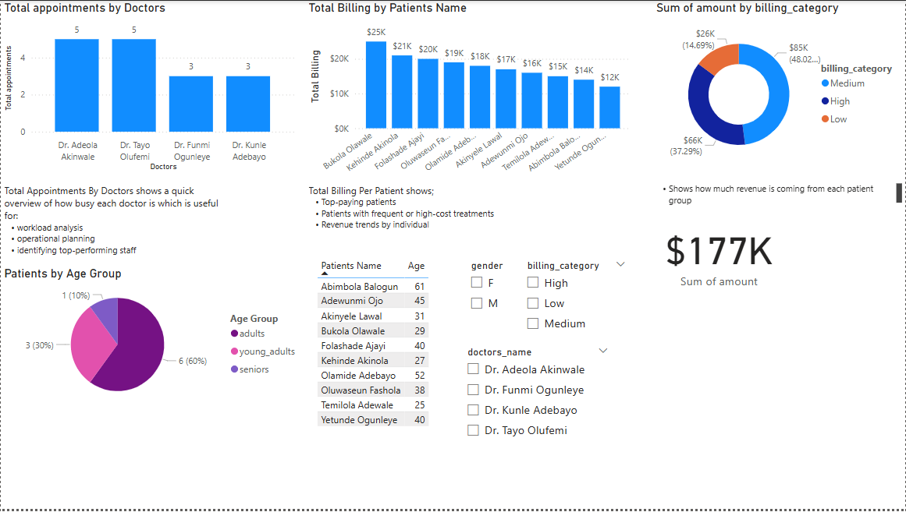
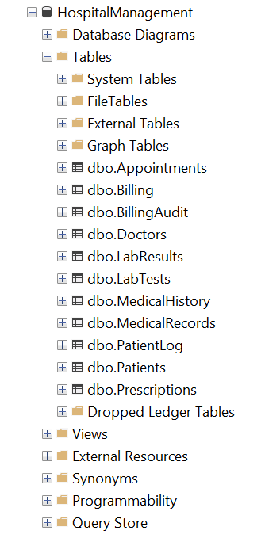
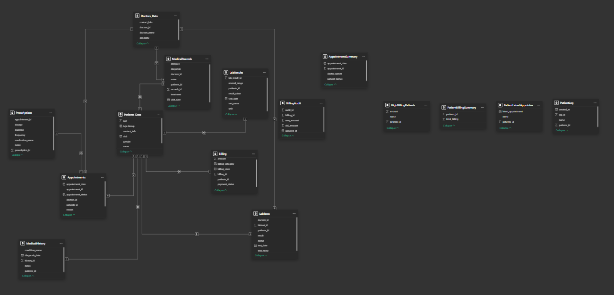
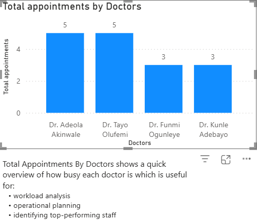

# Hospital Performance Analytics: SQL Server + Power BI


An end-to-end healthcare analytics project built from scratch. I designed a hospital database in SQL Server, wrote queries from basic to advanced, then connected Power BI to it to analyse doctor workload, billing and patient demographics.



---

## Business questions

- How is appointment workload spread across doctors?
- Which patients and billing tiers drive revenue?
- What does the patient population look like by age group and gender?

## 1 · Database design (SQL Server)

**9 related tables:** Patients, Doctors, Appointments, Prescriptions, MedicalRecords, Billing, LabTests, MedicalHistory and LabResults. They are linked by primary and foreign keys and loaded with mock data.



## 2 · SQL analysis

| Level | Techniques | Example |
|---|---|---|
| Basic | `SELECT`, `WHERE`, `ORDER BY`, aliases | [screenshot](screenshots/3_basic_select.png) |
| Intermediate | `GROUP BY` / `HAVING`, `INNER` / `LEFT` / `RIGHT` / `FULL` / `CROSS` joins, subqueries, `CASE` | [join](screenshots/4_join_query.png) · [group by](screenshots/5_groupby_having.png) · [age groups](screenshots/6_case_statement_of_agegroup.png) |
| Advanced | 4 views, 2 stored procedures, 2 audit triggers (patient insert log, billing update audit) | [trigger](screenshots/7_trigger_code.png) |

All the SQL is in [`hospital_management.sql`](hospital_management.sql).

## 3 · Power BI dashboard

Power BI connects directly to SQL Server, where the data was cleaned and modelled.

| Visual | Insight |
|---|---|
| Appointments by doctor | Workload balance, which supports staffing decisions |
| Billing by patient | Highest-revenue patients |
| Billing category (donut) | Revenue split into Low, Medium and High tiers |
| Patients by age group (pie) | Young adults vs adults vs seniors |
| Total revenue card | Headline billing total |
| Slicers | Filter by doctor, billing category and gender |

| Data model | Doctor appointments |
|---|---|
|  |  |

## Files

```
├── hospital_management.sql                    Schema, data, queries, views, procedures, triggers
├── Hospital_Management_Analytics_Dashboard.pbix
└── screenshots/                               SQL and dashboard screenshots (1–12)
```

## Skills shown

Relational database design · T-SQL (joins, subqueries, CASE, views, stored procedures, triggers) · data modelling · Power BI and DAX · dashboard design

---

**Rushikesh Patil** · [GitHub](https://github.com/RushikeshPatil-BA)
